# Scrum × Azure DevOps 實戰教學：用一個「購物車」產品走完整個 Sprint

> 這不是一份「功能清單」式的 Azure DevOps（以下簡稱 ADO）說明書。
> 我們用一個虛構的零售電商團隊 **ShopCart**，從「建立專案」開始，依照 Scrum 的節奏
> **Sprint 0 → Backlog 精煉 → Sprint Planning → Daily Scrum → 開發與 PR → CI → 測試 → Sprint Review → Retrospective**，
> 一步一步帶你操作 ADO。每個步驟都附上實際畫面截圖與說明，讓你看到「這個功能在 Scrum 裡的哪個時間點、為了什麼目的被使用」。

本教材所有截圖皆來自 2026 年 10 月實際操作的 Azure DevOps Services（雲端版）。ADO 介面會持續更新，若你看到的畫面略有不同，請以功能名稱對照。

---

## 目錄

- [0. 情境與學習地圖](#0-情境與學習地圖)
- [1. Azure DevOps 基礎概念](#1-azure-devops-基礎概念)
- [2. Sprint 0：建立專案與團隊設定](#2-sprint-0建立專案與團隊設定)
- [3. Product Backlog：建立與精煉](#3-product-backlog建立與精煉)
- [4. Sprint Planning：承諾與拆解工作](#4-sprint-planning承諾與拆解工作)
- [5. Daily Scrum：用 Taskboard 與 Burndown 追蹤進度](#5-daily-scrum用-taskboard-與-burndown-追蹤進度)
- [6. 開發：Repos、分支原則與 Pull Request](#6-開發repos分支原則與-pull-request)
- [7. 持續整合：Azure Pipelines](#7-持續整合azure-pipelines)
- [8. 測試：Test Case 與 Test Plans](#8-測試test-case-與-test-plans)
- [9. Sprint Review 與 Sprint Retrospective](#9-sprint-review-與-sprint-retrospective)
- [10. 清理環境](#10-清理環境)
- [附錄 A：用腳本一鍵重建本教材環境](#附錄-a用腳本一鍵重建本教材環境)
- [附錄 B：常見問題](#附錄-b常見問題)
- [附錄 C：參考資料](#附錄-c參考資料)

---

## 0. 情境與學習地圖

### 0.1 故事背景

**ShopCart** 是一家零售電商的產品團隊。這一季的目標（OKR）是 **「結帳轉換率提升 15%」**。
Product Owner 把它定義成一個 Epic：**購物車結帳體驗升級**，團隊採用 **2 週一個 Sprint** 的 Scrum 流程開發。

| 項目 | 設定 |
|---|---|
| Organization | `cpingwang0948`（請換成你自己的） |
| Project | `ShopCart-Scrum-Demo` |
| Process（流程範本） | **Scrum** |
| Sprint 1 | 2026/10/19 – 2026/10/30 |
| Sprint 2 | 2026/11/02 – 2026/11/13 |
| 程式碼 | Node.js 購物車服務（本 repo 的 [`sample-app/`](sample-app/)） |

### 0.2 Scrum 事件 ↔ ADO 功能對照

這張表是整份教材的骨幹，後面每一章都對應其中一列：

| Scrum 元素 | 目的 | 主要使用的 ADO 功能 | 章節 |
|---|---|---|---|
| Sprint 0（準備） | 建立專案、團隊、節奏 | Project settings：Iterations、Areas、Team configuration | 2 |
| Product Backlog / Refinement | 產品需求排序與細化 | Boards › Backlogs（Epic / Feature / PBI / Bug）、驗收條件、Effort | 3 |
| Sprint Planning | 決定 Sprint 目標與承諾 | Planning 面板、Sprints › Backlog、Capacity、Work details | 4 |
| Daily Scrum | 檢視進度、移除障礙 | Sprints › Taskboard、Boards（Kanban）、Burndown | 5 |
| 開發（Increment） | 寫程式、Code Review | Repos：Branch、Pull Request、Branch Policies、Work Item 連結 | 6 |
| Definition of Done：建置與測試 | 確保品質 | Pipelines（YAML CI）、Test Plans / Test Case | 7、8 |
| Sprint Review | 展示成果、收集回饋 | Queries、Dashboards、Wiki | 9 |
| Sprint Retrospective | 持續改善 | Wiki（回顧紀錄）、行動項目回寫 Backlog | 9 |

### 0.3 端到端流程圖

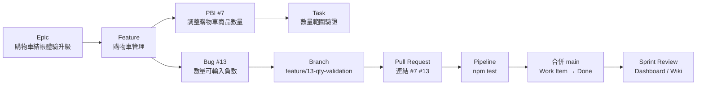

> **學習重點**：在 ADO 裡，需求（Work Item）、程式碼（Commit / PR）、建置（Pipeline）、測試（Test Case）是**互相連結**的。這條「追溯鏈」才是 ADO 相對於單純看板工具最大的價值。

---

## 1. Azure DevOps 基礎概念

### 1.1 三層結構：Organization › Project › Team

| 層級 | 說明 | 本教材範例 |
|---|---|---|
| **Organization** | 最上層容器，對應一個網址 `https://dev.azure.com/<org>`，管理帳號、計費、授權 | `cpingwang0948` |
| **Project** | 一個產品或系統，包含自己的 Boards、Repos、Pipelines… | `ShopCart-Scrum-Demo` |
| **Team** | 專案內的一群人，擁有自己的 Backlog、Sprint、容量 | `ShopCart-Scrum-Demo Team`（建立專案時自動產生） |

### 1.2 五大服務

| 服務 | 用途 | 在 Scrum 中的角色 |
|---|---|---|
| **Boards** | Work Item、Backlog、Sprint、看板、查詢 | 管理 Product Backlog 與 Sprint Backlog |
| **Repos** | Git 版本控制、Pull Request、分支原則 | 產出 Increment、Code Review |
| **Pipelines** | CI/CD 自動化建置、測試、部署 | 落實 Definition of Done |
| **Test Plans** | 手動 / 探索式測試管理 | 驗收測試、品質追蹤 |
| **Artifacts** | 套件庫（npm、NuGet、Maven、Python…） | 分享共用元件（本教材不深入） |

### 1.3 Process（流程範本）怎麼選？

建立專案時要選擇 Process，它決定了 Work Item 類型與狀態。

| Process | 需求項目名稱 | 估算欄位 | 適合 |
|---|---|---|---|
| Basic | Issue | Effort | 最簡單，小團隊 |
| Agile | User Story | Story Points | 一般敏捷團隊 |
| **Scrum** | **Product Backlog Item (PBI)** | **Effort** | **採用 Scrum 框架的團隊（本教材）** |
| CMMI | Requirement | Size | 需要正式變更管理的組織 |

**Scrum 範本的 Work Item 階層與狀態：**

```
Epic                     （大型商業目標，跨多個 Sprint）
 └─ Feature              （可交付的功能群組）
     ├─ Product Backlog Item   New → Approved → Committed → Done
     ├─ Bug                    New → Approved → Committed → Done
     └─ (PBI / Bug 底下)
         └─ Task               To Do → In Progress → Done
```

- **PBI 的 Committed**：代表團隊在 Sprint Planning 承諾本 Sprint 完成它。
- **Task 的 Remaining Work（小時）**：Daily Scrum 時更新，驅動 Burndown 圖。

### 1.4 授權注意事項（初學者最常踩雷）

| 授權 | 費用 | 可用功能 |
|---|---|---|
| Stakeholder | 免費 | 有限的 Boards 功能，適合只看進度的利害關係人 |
| Basic | 前 5 位免費 | Boards、Repos、Pipelines、Artifacts 完整功能；Test Plans 僅部分功能 |
| Basic + Test Plans | 付費（可試用 30 天） | 完整 Test Plans（建立 Test Plan / Suite、參數、組態…） |

> Pipelines 的 **Microsoft-hosted 平行作業**在新 Organization 預設可能是 **0**，需要申請免費額度或自建 Agent，詳見 [第 7 章](#7-持續整合azure-pipelines)。

---

## 2. Sprint 0：建立專案與團隊設定

> **Scrum 情境**：團隊剛組成，Scrum Master 負責把「工作環境」準備好：建立專案、定義 Sprint 節奏、劃分產品模組（Area）、確認團隊成員。

### Step 2.1 進入 Organization 首頁

登入 `https://dev.azure.com/<your-org>`，左側是你可存取的 Organization 清單，右側是此 Organization 下的專案。點右上角 **+ New project**。

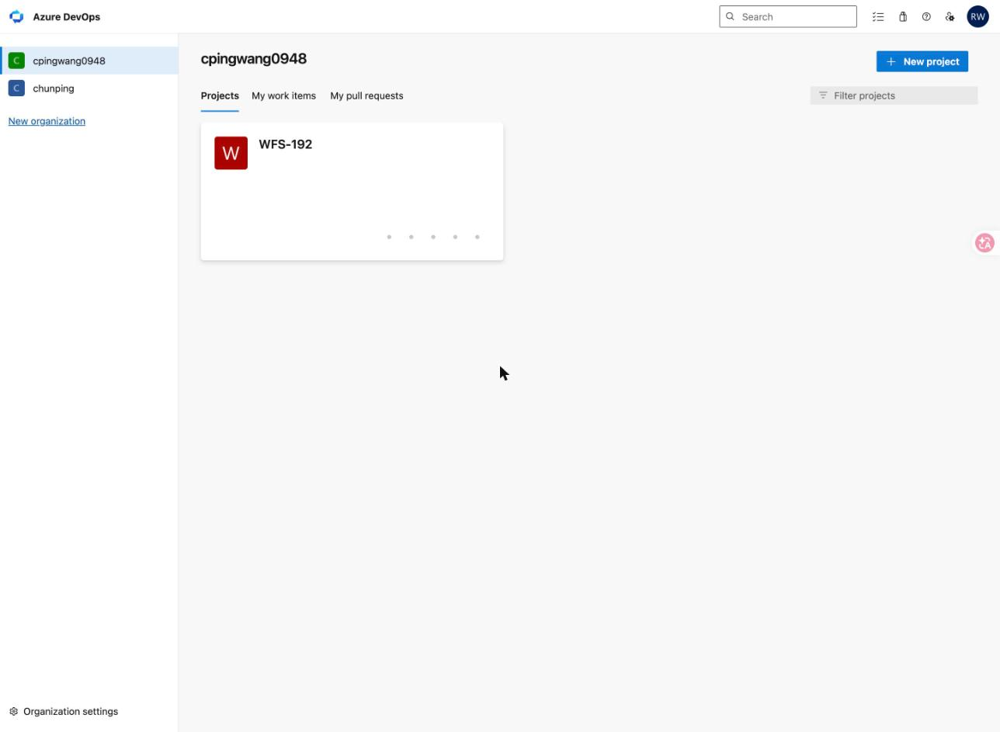

### Step 2.2 建立 Scrum 專案

1. **Project name**：`ShopCart-Scrum-Demo`
2. **Description**：描述專案目的（會顯示在專案首頁）
3. **Visibility**：`Private`（僅受邀者可見）
4. 展開 **Advanced**：
   - **Version control**：`Git`
   - **Work item process**：選 **`Scrum`**（⚠️ 預設是 Basic，一定要改）
5. 點 **Create**

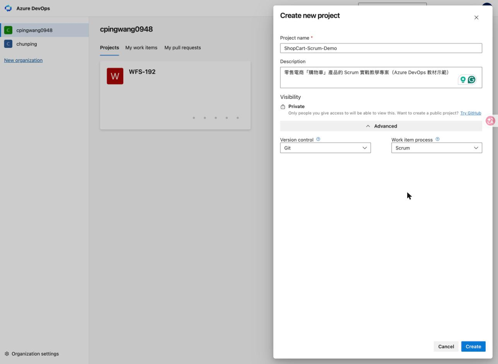

> 💡 Process 建立後雖然可以變更，但牽涉 Work Item 類型轉換，建議一開始就選對。

### Step 2.3 認識專案首頁與左側導覽

建立完成後會進入 **Overview › Summary**。左側導覽列就是 ADO 的五大服務：Boards、Repos、Pipelines、Test Plans、Artifacts；最下方的 **Project settings** 是所有設定的入口。右側 **Members** 顯示目前成員，可用 **Invite** 邀請團隊成員。

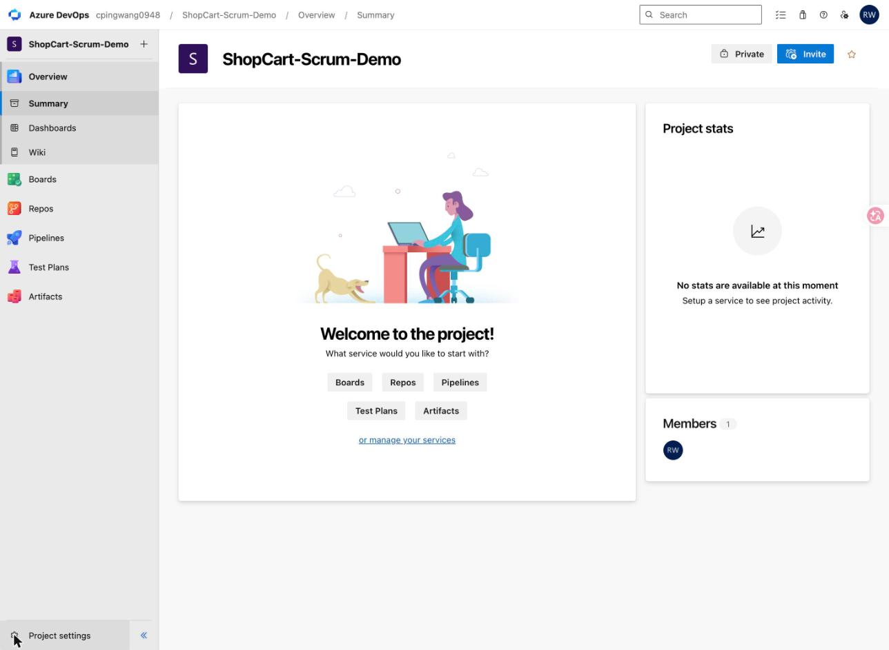

### Step 2.4 設定 Sprint（Iterations）日期

Scrum 範本預設會建立 `Sprint 1` ~ `Sprint 6`，但**沒有日期**。沒有日期的 Sprint 無法計算容量與 Burndown。

1. **Project settings › Boards › Project configuration › Iterations**
2. 對 `Sprint 1` 按兩下（或滑鼠移上去點 `…` › Edit）
3. 輸入 **Start date** `10/19/2026`、**End date** `10/30/2026` › **Save and close**
4. 同樣設定 `Sprint 2`：`11/2/2026` ~ `11/13/2026`

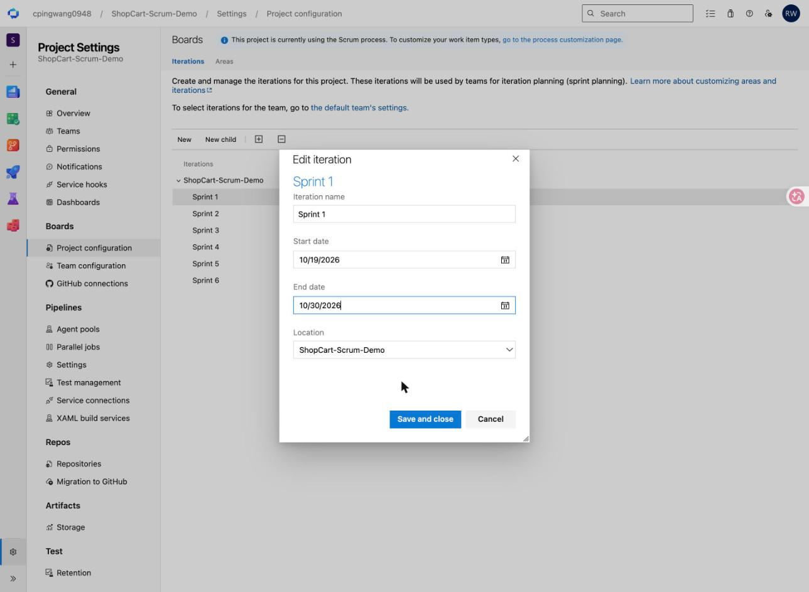

完成後的 Iterations 清單：

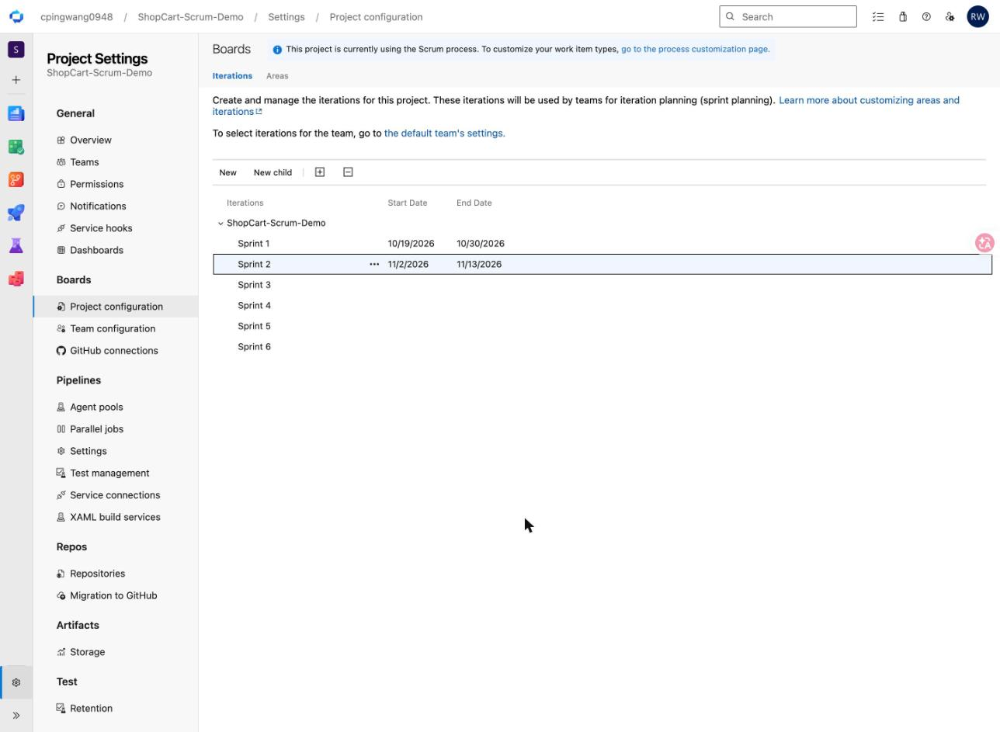

### Step 2.5 建立 Area（產品模組）

**Area** 用來依「產品模組 / 子系統」分類 Work Item，常用於多團隊分工或報表篩選。

1. 同一頁切換到 **Areas** 頁籤
2. 選取根節點 `ShopCart-Scrum-Demo` › **New child**
3. 依序建立：`Web 前台`、`Cart API`、`Payment`

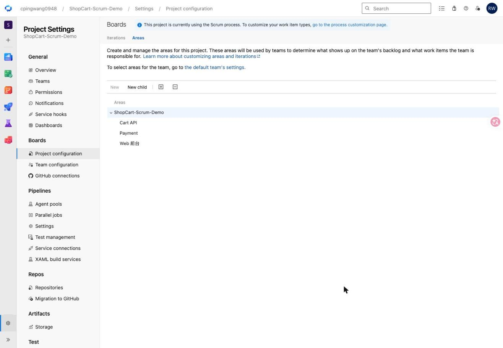

### Step 2.6 團隊設定（Team configuration）

**Project settings › Boards › Team configuration** 是「這個團隊」的看板行為設定，有四個頁籤：

**(1) General**：
- **Backlog navigation levels**：勾選 **Epics**（預設只有 Features 與 Backlog items），才能在 Backlog 看到完整三層階層
- **Working days**：設定工作日（影響容量與 Burndown）
- **Working with bugs**：選 *Bugs are managed with requirements*，讓 Bug 跟 PBI 一起排在 Product Backlog（Scrum 常見做法）

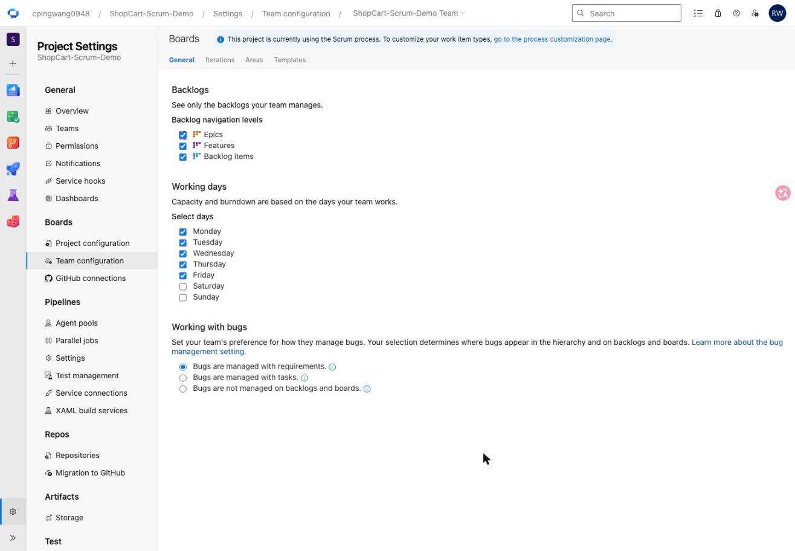

**(2) Iterations**：決定此團隊參與哪些 Sprint。
- **Default iteration**：在 Backlog 新增項目時的預設 Sprint（預設 `@CurrentIteration`）
- **Backlog iteration**：團隊 Backlog 的根節點

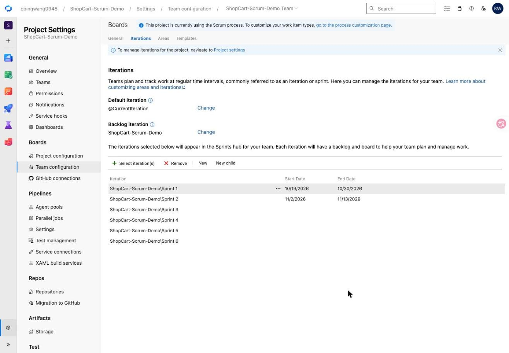

> ⚠️ **常見陷阱**：Default iteration 為 `@CurrentIteration` 時，在 Backlog 新增的 Epic / Feature 也會被放進「目前 Sprint」。Epic 與 Feature 通常跨 Sprint，建議手動把它們的 Iteration 改回根節點 `ShopCart-Scrum-Demo`，或把 Default iteration 改為 Backlog iteration。

**(3) Areas**：選擇此團隊負責的 Area，記得勾選 **Include sub areas**，否則子 Area 的項目不會出現在團隊 Backlog。

### Step 2.7 團隊與成員

**Project settings › General › Teams** 可以看到預設團隊，點進去可新增成員（Scrum Team 包含 Product Owner、Scrum Master、Developers）。大型產品可在此建立多個團隊，各自擁有 Backlog 與 Sprint。

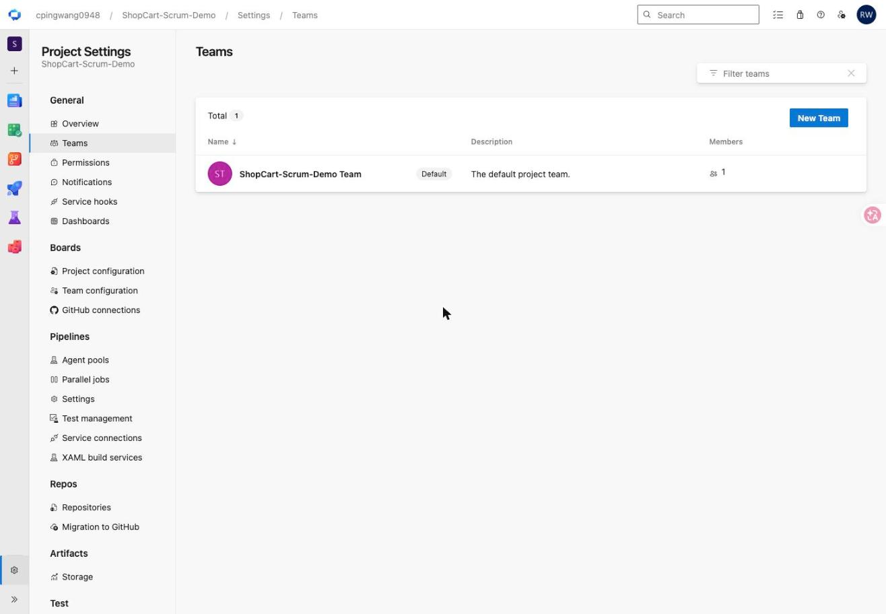

---

## 3. Product Backlog：建立與精煉

> **Scrum 情境**：Product Owner 把 OKR 拆成 Epic → Feature → PBI，並在 Backlog Refinement 會議中與團隊一起補上**驗收條件**與**估算（Effort）**，再依價值排序。

### Step 3.1 建立 Epic

1. **Boards › Backlogs**，右上角層級切換器選 **Epics**
2. 點 **+ New Work Item**，輸入標題 `購物車結帳體驗升級` › **Add to top**

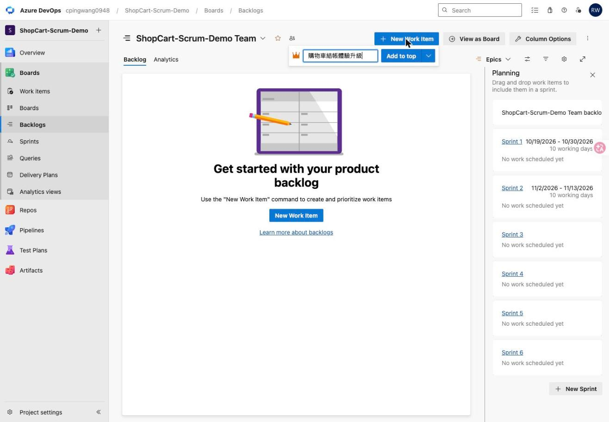

### Step 3.2 認識 Work Item 表單

點擊標題開啟表單。重要欄位：

| 區塊 | 欄位 | 說明 |
|---|---|---|
| 標頭 | Assigned To、State、Reason | 負責人與狀態 |
| 標頭 | Area、Iteration | 屬於哪個模組、哪個 Sprint |
| 左側 | Description、Acceptance Criteria、Discussion | 需求內容、驗收條件、討論（可 `@人`、`#工作項目`） |
| 中間 | Priority、Effort、Business Value、Time Criticality | 排序與估算依據 |
| 右側 | Development | 連結 Branch / Commit / PR（第 6 章） |
| 右側 | Related Work | Parent / Child / Related 等關聯 |

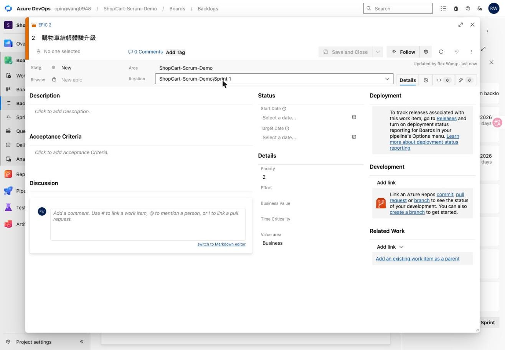

### Step 3.3 建立 Feature 與 PBI，形成階層

在 Backlog 中，滑鼠移到 Epic 列左側的 **`+`** 可直接新增子項目（Feature），對 Feature 再按 `+` 新增 PBI。本教材建立的 Backlog：

| Feature | PBI / Bug | Effort | Sprint |
|---|---|---|---|
| 購物車管理 | #6 加入商品到購物車 | 5 | Sprint 1 |
| | #7 調整購物車商品數量 | 3 | Sprint 1 |
| | #13 (Bug) 購物車數量可輸入負數 | 1 | Sprint 1 |
| | #8 移除購物車商品 | 2 | Sprint 1 |
| 優惠與金額計算 | #9 套用折扣碼 | 5 | Sprint 2 |
| | #10 計算運費與應付總額 | 3 | Sprint 2 |
| 結帳付款 | #11 信用卡付款 | 8 | Sprint 2 |
| | #12 訂單確認 Email | 3 | （尚未排入） |

> 💡 大量建立可使用 [`scripts/02-seed-backlog.sh`](scripts/02-seed-backlog.sh)，或 Boards › Work items › **Import Work Items**（CSV 匯入）。

點左上角 **`+` / `−`**（Expand / Collapse one level）可展開完整階層。右側 **Planning** 面板列出各 Sprint 及其已排入的工作量，可直接**拖曳** PBI 到 Sprint：

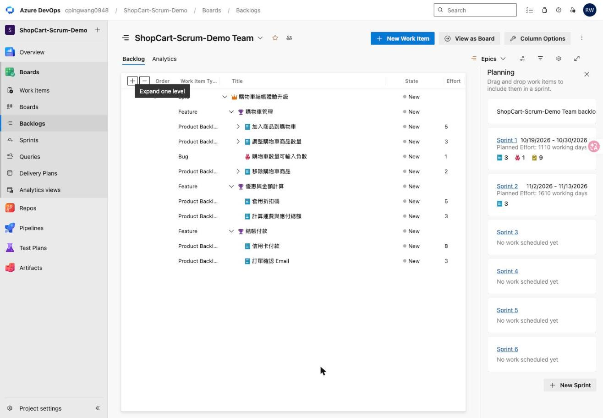

### Step 3.4 精煉 PBI：User Story 與驗收條件

一個「Ready」的 PBI 至少要有：

- **Description**：以 User Story 格式描述「身為 *角色*，我想要 *功能*，以便 *價值*」
- **Acceptance Criteria**：可驗證的條件，建議用 **Given / When / Then**
- **Effort**：團隊估算的相對大小（常用費氏數列 1、2、3、5、8、13）
- **Parent**：往上連到 Feature，讓進度能彙總到 Epic

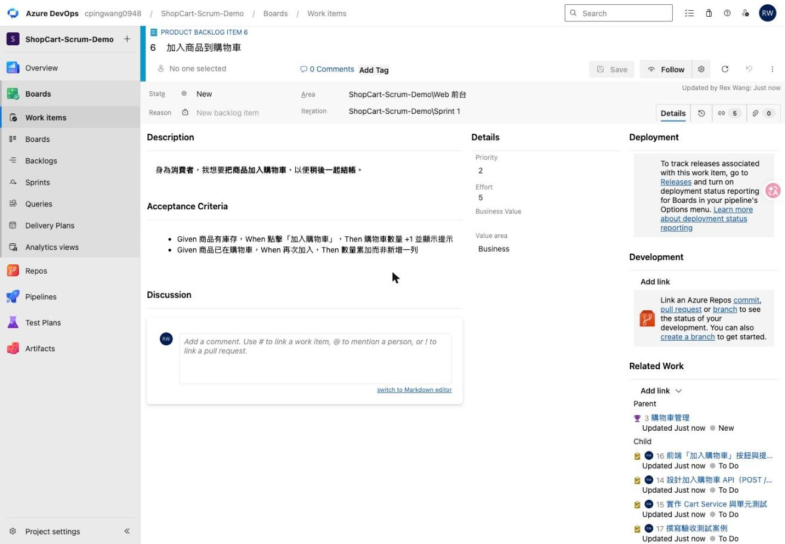

右下角 **Related Work** 可看到 Parent（Feature #3）與 Child（Task），這就是需求的追溯鏈。

### Step 3.5 排序（Ordering）

Product Backlog 的**由上而下順序**就是優先順序。在 Backlog 頁面直接拖曳列即可調整（ADO 會更新隱藏欄位 *Backlog Priority*）。Product Owner 應確保最上方的項目已精煉完成，可隨時被拉進 Sprint。

---

## 4. Sprint Planning：承諾與拆解工作

> **Scrum 情境**：Sprint 1 第一天，團隊與 PO 一起決定 **Sprint Goal：「消費者可以把商品加入購物車並調整數量」**，從 Backlog 頂端挑選 PBI，拆解成 Task 並估計時數，最後確認不超過團隊容量。

### Step 4.1 把 PBI 排進 Sprint

在 **Boards › Backlogs** 把 #6、#7、#8、#13 拖曳到右側 Planning 面板的 **Sprint 1**（或在表單中直接修改 Iteration）。接著把這些項目的 **State** 改為 **Committed**，表示團隊承諾。

### Step 4.2 設定團隊容量（Capacity）

**Boards › Sprints**，選 `Sprint 1` › **Capacity** 頁籤：

- **Activity**：此成員主要的工作類型（Development、Design、Testing…）
- **Capacity per day**：每天可投入 Sprint 工作的小時數（扣除會議、行政，常見 5~6 小時）
- **Days off**：請假日（本例 10/23 請假 1 天）
- **Team days off**：全隊放假（例如國定假日）

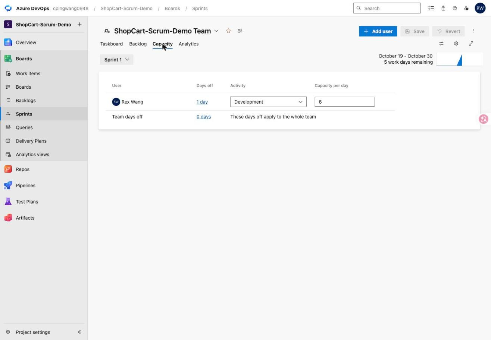

### Step 4.3 拆解 Task 並對照容量

切換到 **Backlog** 頁籤，在每個 PBI 列按 `+` 新增 Task，填入 **Remaining Work（小時）**、**Activity**、**Assigned To**。

點右上角 **View options（滑桿圖示）› Side pane › Work details**，右側會即時顯示：
- **Team**：總 Remaining Work vs. 總容量
- **Work By: Activity**：各類工作 vs. 該類容量
- **Work By: Assigned To**：每個人的負載

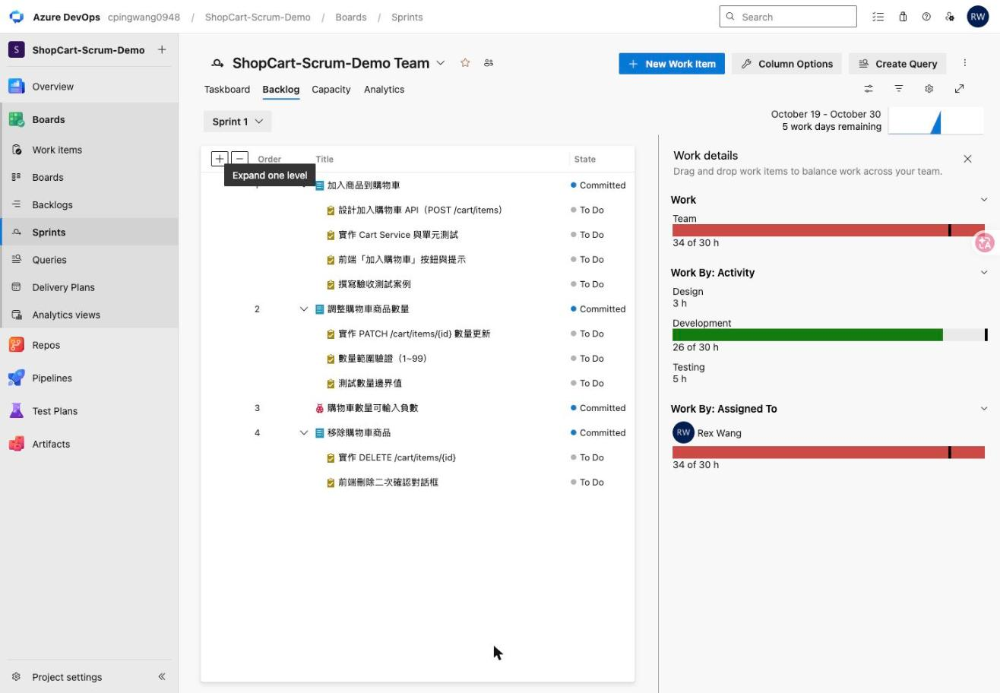

> 🔴 圖中 **Team 34 of 30 h** 呈紅色，代表**超出容量**！這正是 Sprint Planning 要討論的：
> 是要把某個 PBI（例如 #8）移回 Product Backlog，還是縮小範圍？ADO 讓這個決策「看得見」。

---

## 5. Daily Scrum：用 Taskboard 與 Burndown 追蹤進度

> **Scrum 情境**：每天早上 15 分鐘，Developers 站在 Taskboard 前檢視：昨天完成什麼、今天做什麼、有沒有障礙。

### Step 5.1 Taskboard（Sprint 工作看板）

**Boards › Sprints › Taskboard**。每一列（Swimlane）是一個 PBI / Bug，欄位是 Task 狀態 **To Do → In Progress → Done**。

Daily Scrum 時每位成員：
1. 把卡片**拖曳**到正確欄位
2. 更新卡片右下角的 **Remaining Work**（點數字直接改）
3. 遇到障礙時，在 PBI 加上 Tag `Blocked` 或建立 **Impediment** 工作項目

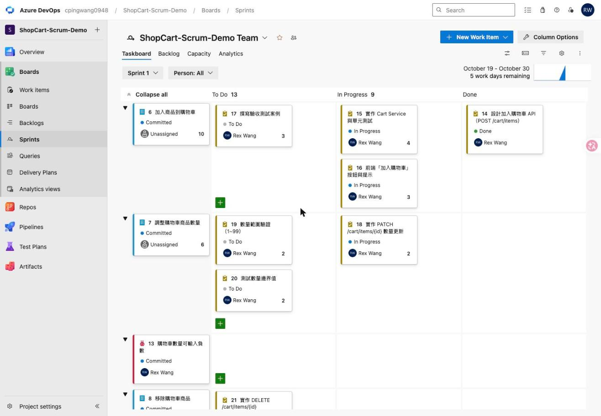

> 💡 上方 **Person: All** 可切換為只看自己的卡片；PBI 卡片右下的數字是其底下 Task 的 Remaining Work 加總。

### Step 5.2 Kanban Board（PBI 層級的流程看板）

**Boards › Boards** 顯示 PBI 層級的看板（欄位 New → Approved → Committed → Done）。卡片下方的 `1/4` 表示 4 個 Task 已完成 1 個。欄位標題的 `4/5` 是 **WIP Limit**（在製品上限），超過時會變紅，提醒團隊「先完成，再開始」。

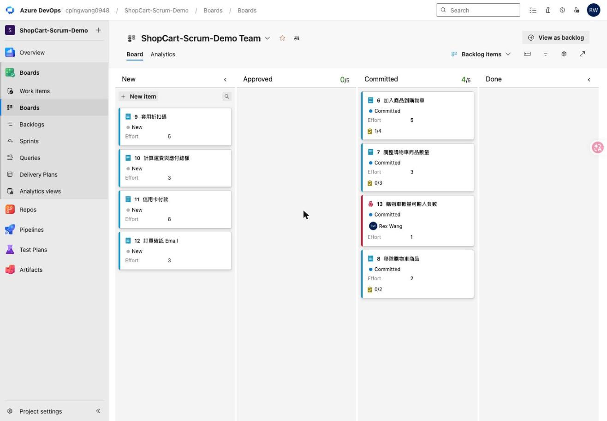

> **Taskboard vs. Board**：Taskboard 看「這個 Sprint 的 Task」；Board 看「PBI 在整個流程中的流動」，常用於 Backlog Refinement 與跨 Sprint 追蹤。

### Step 5.3 Burndown（燃盡圖）

**Sprints › Analytics** 頁籤顯示 **Burndown Trend**：

- **藍色區域 Remaining**：每天剩餘工作量
- **灰色線 Ideal Trend**：理想的燃盡速度
- **綠色虛線 Remaining Capacity**：剩餘容量
- 上方指標：Completed %、Average burndown、Total Scope Increase

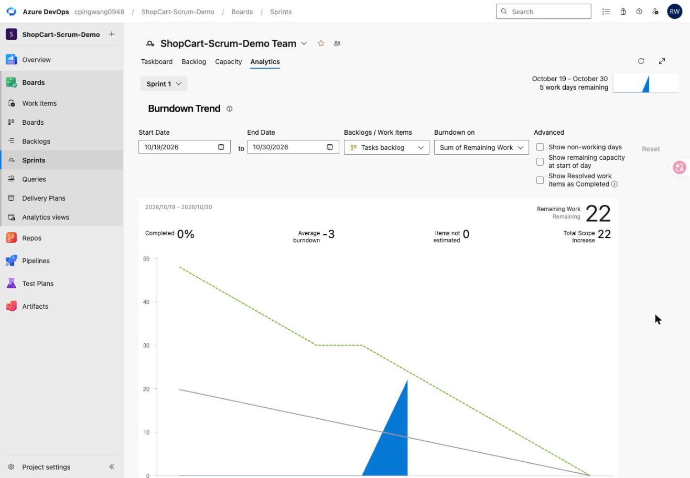

> 📌 **如何解讀本圖**：本教材的 Task 是在 Sprint 中途（10/26）才建立，所以 Remaining 從 0 突然「長高」到 22 小時，而 **Total Scope Increase = 22**。
> 這正好示範了一個真實的反模式：**Sprint 中途大量加入工作會讓 Burndown 失真**。正確做法是在 Sprint Planning（第一天）就完成 Task 拆解。

---

## 6. 開發：Repos、分支原則與 Pull Request

> **Scrum 情境**：Developer 認領 Bug #13 與 PBI #7（兩者都和「數量驗證」有關），從 Work Item 直接建立分支、提交程式碼、發 PR 請同伴 Review。

### Step 6.1 初始化 Repository

**Repos › Files**。新專案會自動建立一個與專案同名的空 Git Repo，頁面提供四種方式：

1. **Clone to your computer**：HTTPS / SSH 網址，或直接用 VS Code 開啟
2. **Push an existing repository from command line**：把本機既有專案推上來
3. **Import a repository**：從 GitHub 等外部 Git 匯入
4. **Initialize main branch with a README or gitignore**

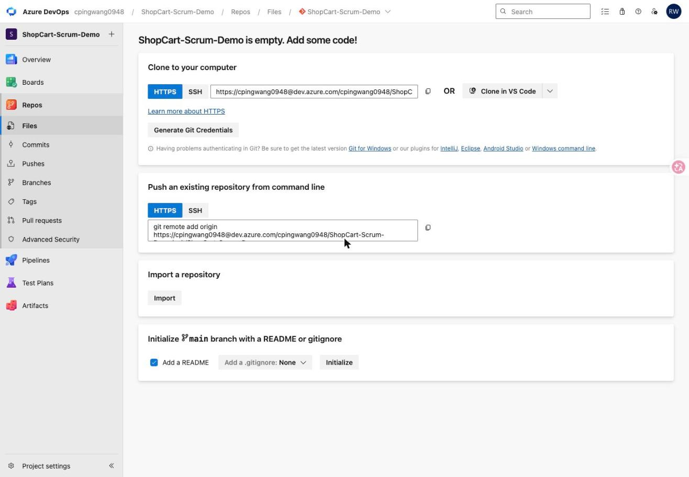

本教材把 [`sample-app/`](sample-app/) 推送上去作為初始程式碼：

```bash
cd sample-app
git init -b main
git add .
git commit -m "Initial commit: 購物車服務骨架與 CI pipeline"
git remote add origin https://<org>@dev.azure.com/<org>/ShopCart-Scrum-Demo/_git/ShopCart-Scrum-Demo
git push -u origin main
```

> 🔑 HTTPS 驗證可用 **Generate Git Credentials** 產生的密碼，或安裝 Git Credential Manager 以瀏覽器登入。

### Step 6.2 從 Work Item 建立分支（自動連結）

打開 Bug #13，右側 **Development › create a branch**：

- **Name**：`feature/13-qty-validation`（建議命名包含 Work Item ID）
- **Based on**：`main`
- **Work items to link**：自動帶入 Bug #13

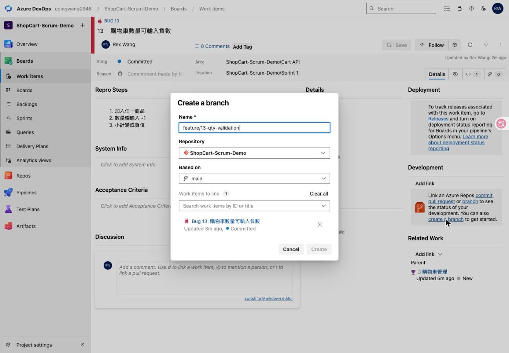

用這種方式建立的分支會**自動連結**到 Work Item，之後在這個分支上的 PR 也會自動帶入。

### Step 6.3 提交程式碼

在本機切到新分支並提交修正（完整程式見 [`sample-app/src/cart.js`](sample-app/src/cart.js)）：

```bash
git fetch && git checkout feature/13-qty-validation
# 修改 src/cart.js 新增 updateQty() 驗證、test/cart.test.js 新增測試
npm test
git commit -am "Fix #13: 數量須介於 1~99，新增 updateQty 驗證與測試 (AB#7)"
git push
```

> 💡 Commit 訊息中的 `#13`、`#7` 會被 ADO 辨識並連結到對應的 Work Item。

**Repos › Branches** 可以看到分支清單、Behind / Ahead 數、最近一次建置狀態（`main` 旁的紅色 ✕ 是第 7 章的 Pipeline 結果）：

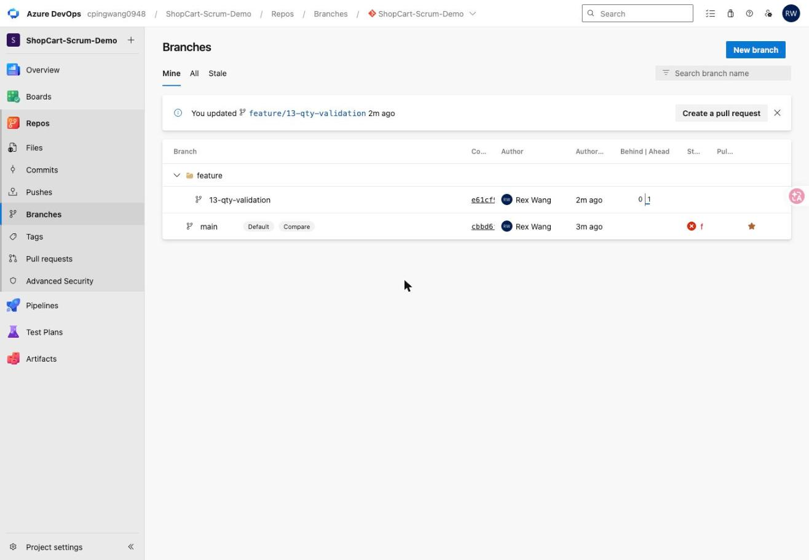

### Step 6.4 設定 main 分支原則（Branch Policies）

分支原則是把 **Definition of Done** 「系統化」的關鍵。在 Branches 頁面 `main` 列點 **`⋮` › Branch policies**：

| 原則 | 本教材設定 | 用途 |
|---|---|---|
| Require a minimum number of reviewers | **On**，最少 1 人；勾選 *Allow requestors to approve their own changes*（僅因示範只有一人，實務請勿勾選） | 強制 Code Review |
| Check for linked work items | **On，Required** | 每個 PR 都必須能追溯到需求 |
| Check for comment resolution | （可選） | 所有 Review 意見都要處理 |
| Limit merge types | （可選）例如只允許 Squash merge | 保持 main 歷史乾淨 |
| Build Validation | （第 7 章 Pipeline 可執行後再加） | PR 必須通過 CI 才能合併 |

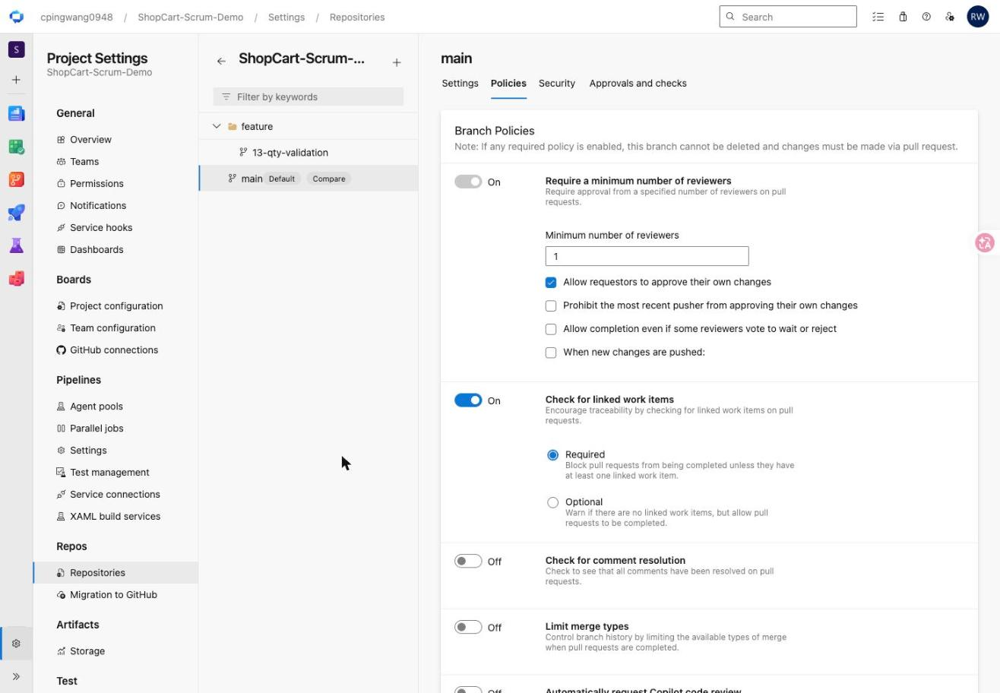

> ⚠️ 一旦啟用任一 Required 原則，`main` 就**不能直接 push**，所有變更都必須透過 PR。

### Step 6.5 建立 Pull Request

**Repos › Pull requests › New pull request**（或在 Branches 頁面的提示列點 **Create a pull request**）：

1. 來源 `feature/13-qty-validation` → 目標 `main`
2. **Title / Description**：支援 Markdown，可加入核取清單（`- [x]`）
3. **Reviewers**：加入審查者
4. **Work items to link**：已自動帶入 PBI #7 與 Bug #13（來自分支連結與 commit 訊息）
5. 點 **Create**

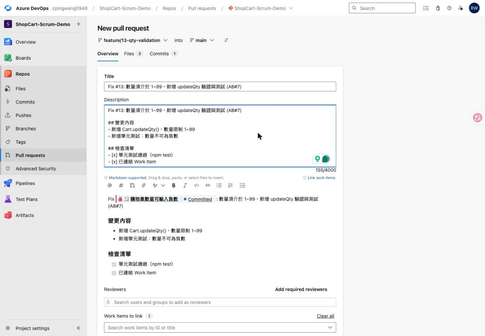

### Step 6.6 審查 PR

PR 的 **Overview** 頁籤上方會列出所有分支原則的檢查狀態：

- ✅ **Work items must be linked**：已通過
- 🕒 **At least 1 reviewer must approve**：等待審查
- ✅ **No merge conflicts**

右側 **Work items** 區塊顯示連結的 PBI #7 與 Bug #13。

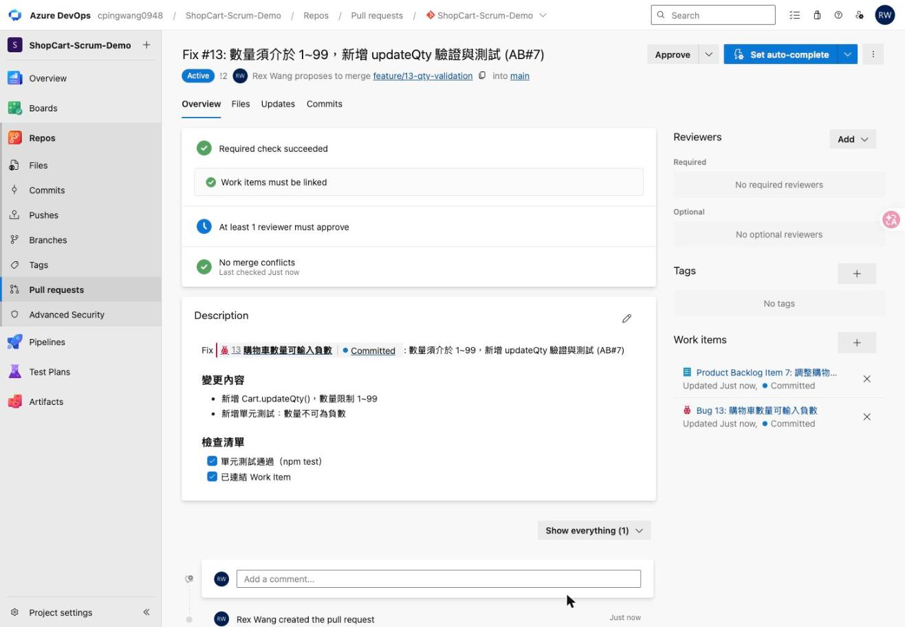

**Files** 頁籤可逐行檢視差異，滑鼠移到行號旁可新增**行內評論（Comment）**，與作者討論修改：

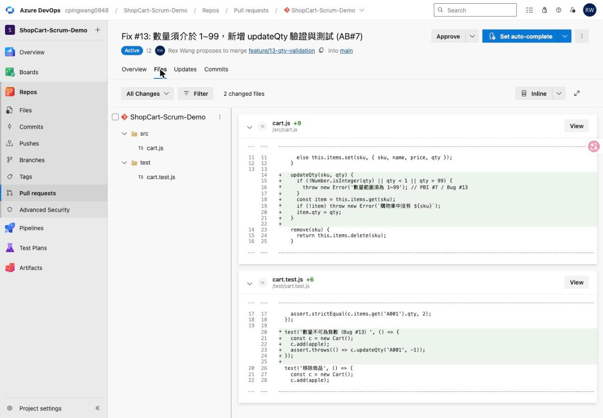

### Step 6.7 核准並完成 PR

由**另一位團隊成員**（Reviewer）執行：

1. 右上角 **Approve**（或 Approve with suggestions / Wait for author / Reject）
2. 所有原則通過後，點 **Complete**，在對話框選擇：
   - **Merge type**：建議 `Squash commit`
   - ☑ **Complete associated work items after merging**：合併後自動把 #7、#13 轉為 **Done**
   - ☑ **Delete feature/13-qty-validation after merging**
3. 也可在建立 PR 時勾選 **Set auto-complete**：原則全部通過後自動合併

> 📝 本教材示範環境只有一位成員，核准與合併請由讀者在自己的環境以 Reviewer 身分完成。

---

## 7. 持續整合：Azure Pipelines

> **Scrum 情境**：DoD 規定「單元測試全部通過」。團隊用 YAML Pipeline 讓每次 push 與 PR 都自動跑測試。

### Step 7.1 認識 azure-pipelines.yml

Pipeline 定義以 YAML 檔放在程式碼 repo 中（Pipeline as Code），本教材的 [`sample-app/azure-pipelines.yml`](sample-app/azure-pipelines.yml)：

```yaml
trigger:            # push 到 main 時觸發
  branches:
    include: [main]
pr:                 # 對 main 發 PR 時觸發（Azure Repos 請改用 Build Validation 原則）
  branches:
    include: [main]
pool:
  vmImage: ubuntu-latest   # 使用 Microsoft-hosted Agent
steps:
  - task: NodeTool@0
    inputs:
      versionSpec: '20.x'
    displayName: '安裝 Node.js 20'
  - script: npm test
    displayName: '執行單元測試'
```

> 💡 YAML 中的 `pr:` 觸發只對 GitHub / Bitbucket 等外部 repo 有效；**Azure Repos 的 PR 驗證要透過分支原則中的 Build Validation 設定**。

### Step 7.2 建立 Pipeline

1. **Pipelines › Create Pipeline**
2. **Where is your code?** 選 **Azure Repos Git**

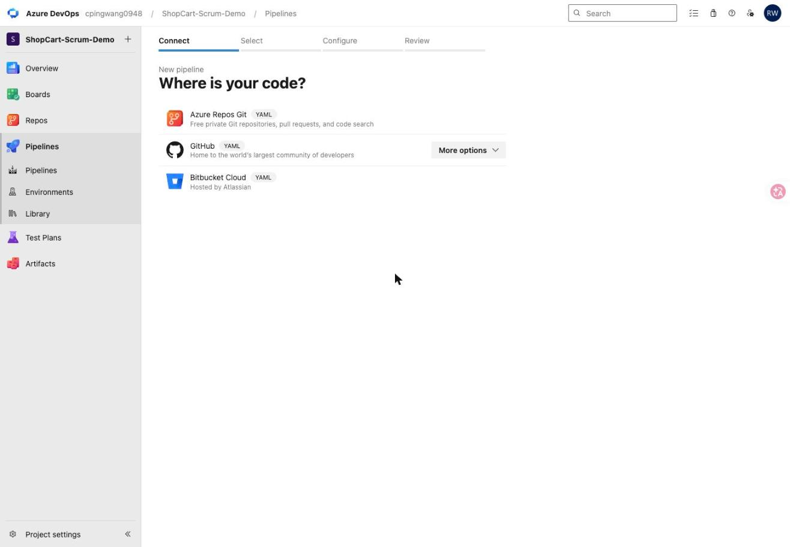

3. **Select a repository**：`ShopCart-Scrum-Demo`
4. 因為 repo 已有 `azure-pipelines.yml`，ADO 會直接進入 **Review your pipeline YAML**
5. 點 **Run**（或下拉選 Save 只儲存）

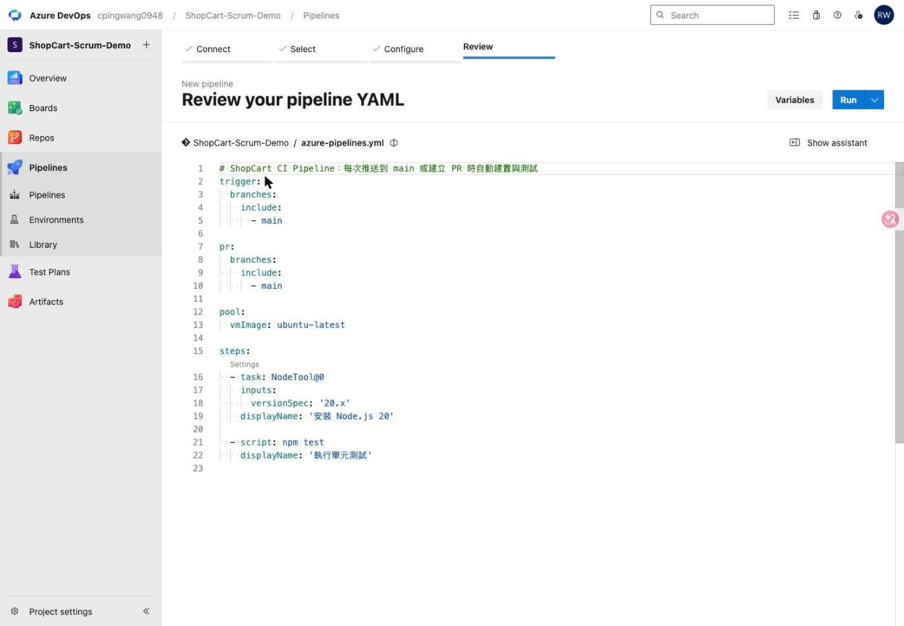

### Step 7.3 第一次執行常見錯誤：No hosted parallelism

新建立的 Organization 執行時很可能看到：

> *No hosted parallelism has been purchased or granted. Please set up billing or purchase parallel jobs.*

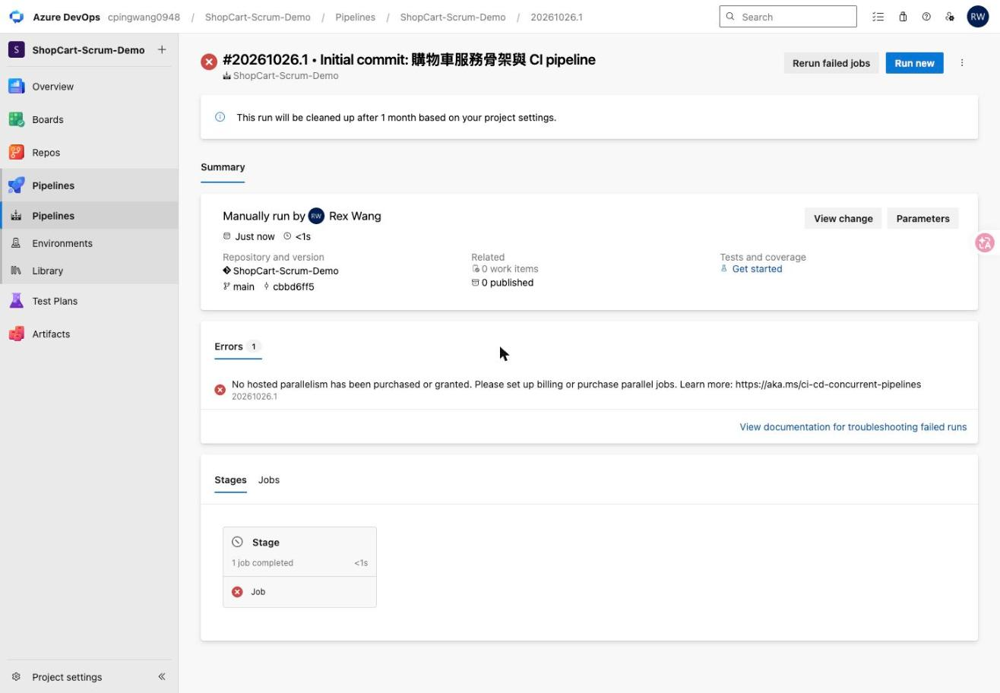

到 **Organization settings › Pipelines › Parallel jobs** 可以看到原因：**Microsoft-hosted = 0**，但 **Self-hosted 有 1 個免費平行作業**。

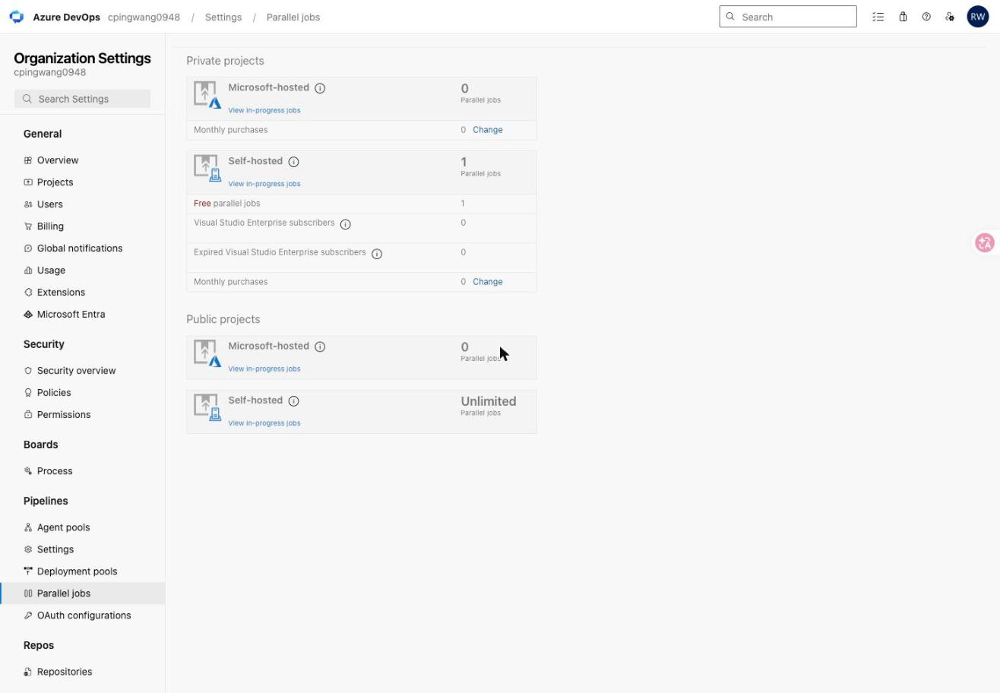

**解法（擇一）：**

| 方案 | 做法 | 優缺點 |
|---|---|---|
| A. 申請免費 Microsoft-hosted 額度 | 填寫 <https://aka.ms/azpipelines-parallelism-request> | 免維護；審核需數個工作天 |
| B. 自建 Self-hosted Agent | 執行 [`scripts/04-setup-self-hosted-agent.sh`](scripts/04-setup-self-hosted-agent.sh)，並把 YAML 的 `pool` 改為 `name: Default` | 立即可用；需自行維護主機 |
| C. 設定計費購買 | Organization settings › Billing | 適合正式團隊 |

完成後回到 Pipeline 點 **Run new**，即可看到 `執行單元測試` 步驟通過，並可在分支原則加上 **Build Validation**，讓 PR 必須 CI 綠燈才能合併。

---

## 8. 測試：Test Case 與 Test Plans

> **Scrum 情境**：驗收條件要能被驗證。團隊為 PBI #6 建立手動測試案例，在 Sprint 結束前執行。

### Step 8.1 建立 Test Case 並連結 PBI

Test Case 也是一種 Work Item。開啟 PBI #6 › Related Work › **Add link › New item**，連結類型選 **Tested By**，類型選 **Test Case**；或在 Test Plans 中建立。

在 **Steps** 頁籤逐步輸入 **Action（操作）** 與 **Expected result（預期結果）**：

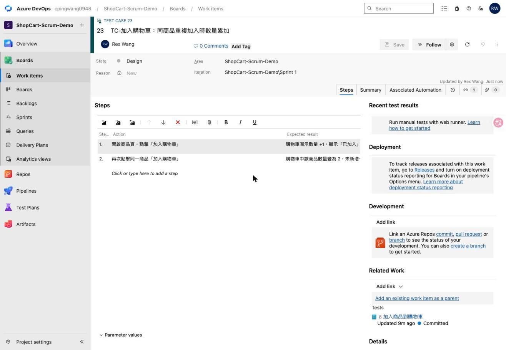

右下角 **Tests** 顯示它驗證的是 PBI #6 —— 需求與測試的追溯關係就此建立。

### Step 8.2 Test Plans 與授權

**Test Plans** 服務可建立 Test Plan（通常一個 Sprint 一個）→ Test Suite（可依 PBI 自動產生 Requirement-based suite）→ 執行測試並記錄 Pass / Fail，失敗時可直接建立 Bug。

若帳號只有 Basic 授權，會看到以下提示：只能使用部分功能，完整功能需 **Basic + Test Plans** 授權或啟用 30 天試用。

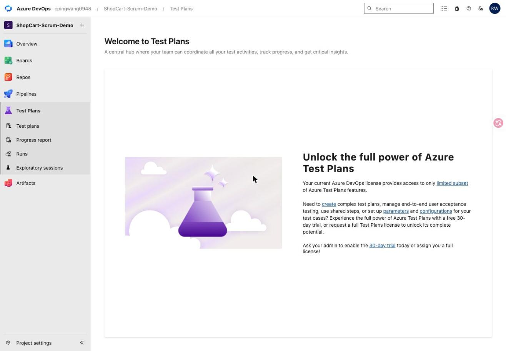

---

## 9. Sprint Review 與 Sprint Retrospective

### 9.1 Sprint Review：展示成果

> **Scrum 情境**：Sprint 最後一天，團隊向 PO 與利害關係人展示「已完成（符合 DoD）」的 Increment，並收集回饋更新 Product Backlog。

#### Step 9.1.1 用 Query 列出 Sprint 完成狀況

**Boards › Queries › New query**，建立「Sprint 1 - 未完成工作」：

| And/Or | Field | Operator | Value |
|---|---|---|---|
| | Iteration Path | = | `@CurrentIteration` + 團隊 |
| And | State | Not In | Done, Removed |

存到 **Shared Queries** 讓全隊共用。查詢結果可匯出、可在 **Charts** 頁籤畫圓餅圖，也能放到 Dashboard。

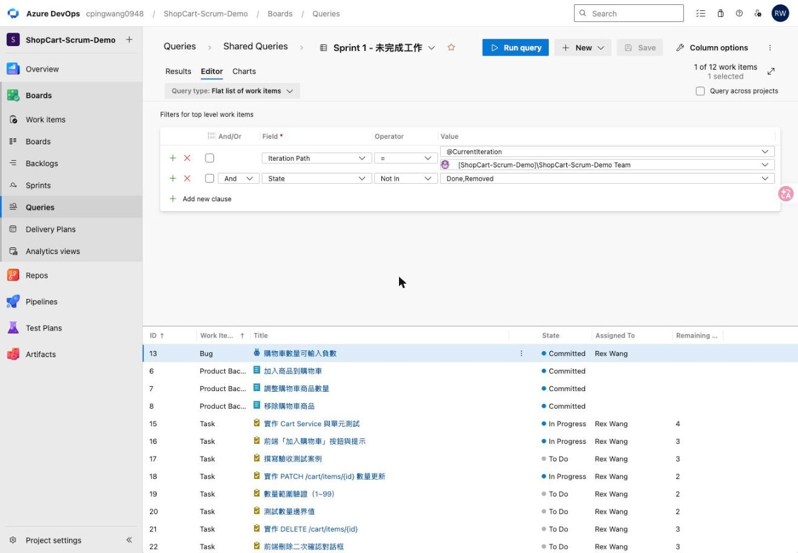

> 💡 `@CurrentIteration`、`@Me`、`@Today` 等巨集讓同一個查詢在每個 Sprint 都能重複使用。

#### Step 9.1.2 建立團隊 Dashboard

**Overview › Dashboards**，點 **Edit** 或 **Add a widget** 開啟 Widget 目錄，搜尋 `Sprint` 並加入：
- **Sprint Burndown**：燃盡圖
- **Sprint Overview**：剩餘天數、工作項目狀態分布
- **Sprint Capacity**：剩餘工作 vs. 容量

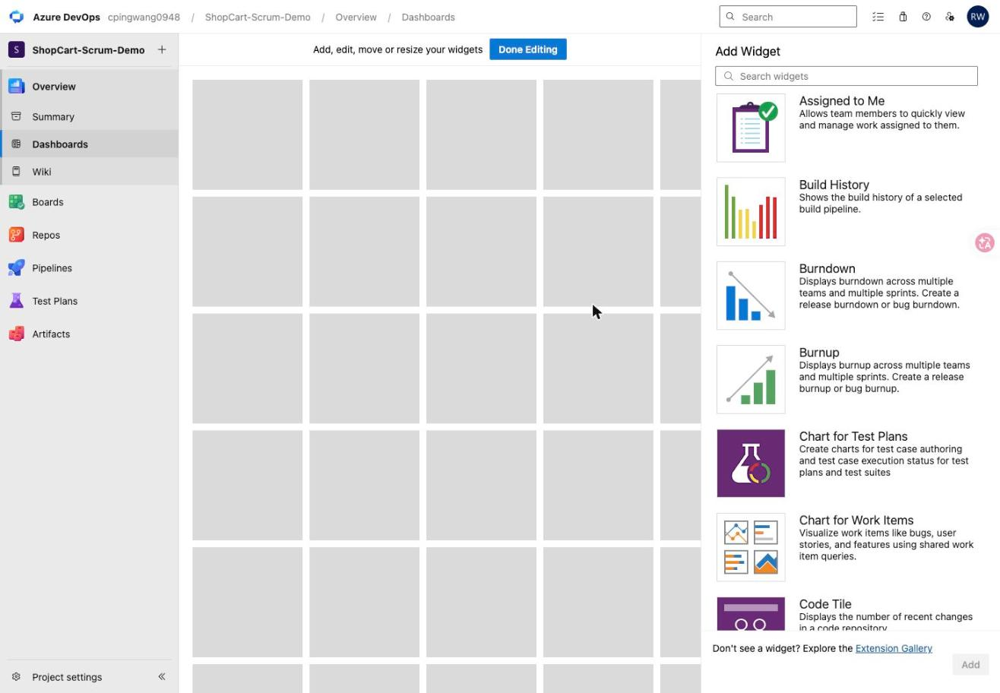

點 **Done Editing** 完成。Sprint Review 時直接投影 Dashboard，利害關係人（即使是 Stakeholder 授權）也能隨時自行查看。

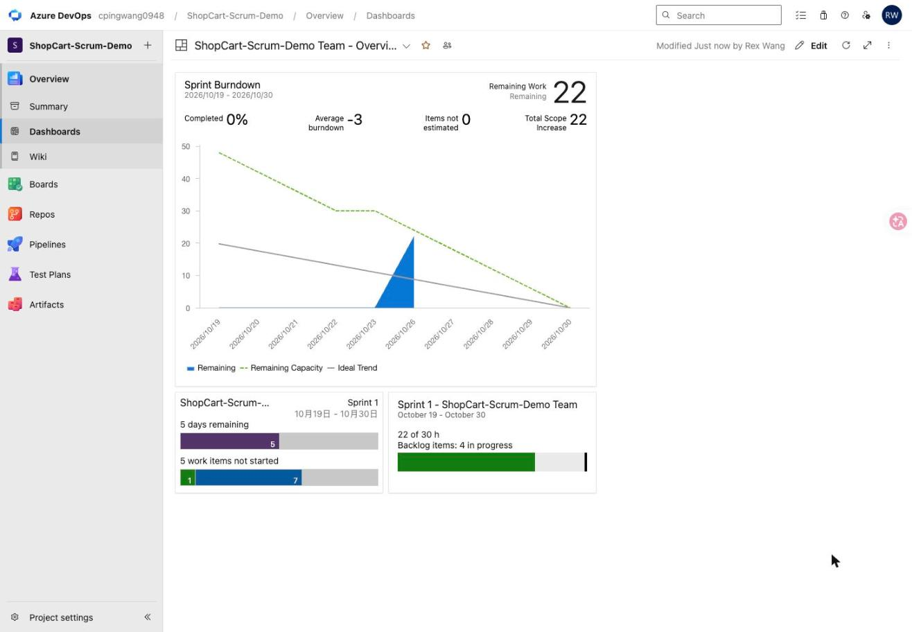

#### Step 9.1.3 在 Wiki 記錄 DoD 與 Review 結果

**Overview › Wiki › Create project wiki**，建立團隊共用頁面：
- **Definition of Done**（所有成員對「完成」的共同定義）
- **Sprint 1 Review**（展示結果與利害關係人回饋，範本見 [`wiki-templates/`](wiki-templates/)）

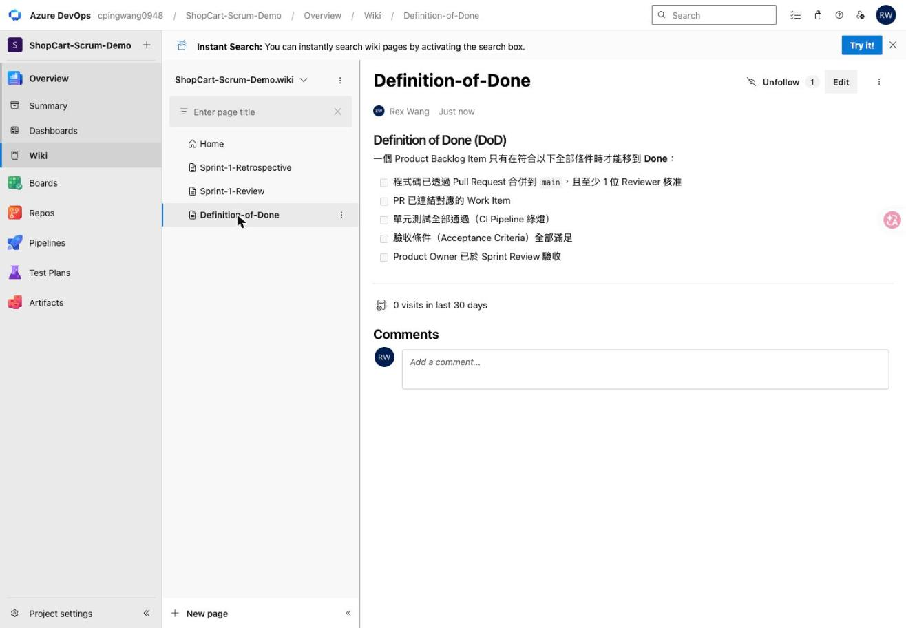

> 💡 Wiki 支援 Markdown、Mermaid 圖表、核取清單；在 Wiki 輸入 `#13` 可連結 Work Item。

#### Step 9.1.4 結束 Sprint 的 Backlog 整理

Sprint Review 後：
1. 已完成且通過 DoD 的 PBI → **Done**
2. 未完成的 PBI（例如 #8）→ 在 Sprint Backlog 拖曳到 Planning 面板的 **Sprint 2**，或移回 Product Backlog
3. 利害關係人的新需求 → 建立新 PBI，由 PO 排序

### 9.2 Sprint Retrospective：持續改善

> **Scrum 情境**：Review 之後，團隊檢討流程本身：什麼做得好、什麼要改、下個 Sprint 要嘗試什麼。

在 Wiki 建立 **Sprint 1 Retrospective** 頁面（範本：[`wiki-templates/Sprint-Retrospective-Template.md`](wiki-templates/Sprint-Retrospective-Template.md)）。本 Sprint 我們從 ADO 數據中發現的兩個問題，正好成為改善行動：

- Sprint Planning 容量超載（第 4 章 Work details 顯示 34h / 30h）
- CI Pipeline 因無 Microsoft-hosted 平行作業額度而無法執行（第 7 章）

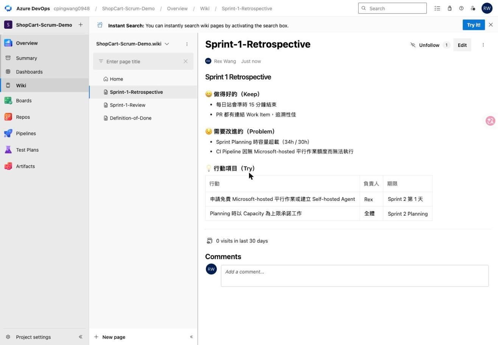

> 💡 **把行動項目變成 Work Item**：Retrospective 的 Try 項目應建立成 Product Backlog 中的 PBI 或 Task，在下個 Sprint Planning 一併承諾，避免「回顧完就忘了」。
> 若想要互動式的回顧看板，可從 Marketplace 安裝 Retrospectives 擴充套件。

---

## 10. 清理環境

教學結束後若要刪除專案：

1. **Project settings › General › Overview** 最下方 **Delete**
2. 輸入專案名稱確認

或執行 [`scripts/99-cleanup.sh`](scripts/99-cleanup.sh)。

> ⚠️ 刪除的專案會進入「已刪除」狀態，**28 天內**可在 **Organization settings › Projects** 還原，之後將永久刪除。

---

## 附錄 A：用腳本一鍵重建本教材環境

本 repo 的結構：

```
.
├── README.md                     # 本教材
├── images/                       # 截圖
├── sample-app/                   # 推送到 Azure Repos 的範例程式（Node.js，無外部相依）
│   ├── src/cart.js
│   ├── test/cart.test.js
│   ├── azure-pipelines.yml
│   └── package.json
├── scripts/
│   ├── 00-env.sh                 # 共用環境變數與 az devops 預設值
│   ├── 01-create-project.sh      # 建立 Scrum 專案、Sprint 日期、Area
│   ├── 02-seed-backlog.sh        # 建立 Epic / Feature / PBI / Bug / Task 與父子關係
│   ├── 03-setup-repo-pipeline.sh # 推送程式、建立 Pipeline、設定分支原則
│   ├── 04-setup-self-hosted-agent.sh  # （選用）安裝 Self-hosted Agent
│   └── 99-cleanup.sh             # 刪除專案
└── wiki-templates/               # DoD、Review、Retrospective 範本
```

**前置需求**：[Azure CLI](https://learn.microsoft.com/cli/azure/install-azure-cli)、Git、Node.js 20+（本機測試用）。

```bash
# 1. 登入並設定環境變數
az login
export ADO_ORG=https://dev.azure.com/<your-org>
export ADO_PROJECT=ShopCart-Scrum-Demo

# 2. 依序執行
bash scripts/01-create-project.sh
bash scripts/02-seed-backlog.sh
bash scripts/03-setup-repo-pipeline.sh

# 3. 本機測試範例程式
cd sample-app && npm test
```

> 腳本使用 `azure-devops` CLI 擴充套件（`00-env.sh` 會自動安裝）。團隊容量（Capacity）、Dashboard Widget 目前 CLI 不直接支援，請依第 4、9 章於網頁操作。

---

## 附錄 B：常見問題

| 問題 | 原因 / 解法 |
|---|---|
| Sprint 沒有出現在 Sprints 頁面 | Sprint 尚未設定日期，或未在 Team configuration › Iterations 中選取 |
| 子 Area 的項目沒出現在 Backlog | Team configuration › Areas 未勾選 *Include sub areas* |
| Backlog 看不到 Epic 層 | Team configuration › General 勾選 *Epics* |
| 新增的 Epic 自動跑進目前 Sprint | Default iteration 為 `@CurrentIteration`，請改 Iteration 或調整預設值 |
| Task 改成 Done 時出現 `TF401320 ... Remaining Work` 錯誤 | Scrum 範本規則：Task 為 Done 時 Remaining Work 必須清空（透過 API / CLI 更新時要一併移除該欄位） |
| Pipeline 出現 *No hosted parallelism* | 見 [Step 7.3](#step-73-第一次執行常見錯誤no-hosted-parallelism) |
| 無法直接 push 到 main | 已啟用分支原則，請改用 PR |
| Burndown 曲線怪怪的 | Sprint 中途加入大量工作（Scope Increase），或 Task 未填 Remaining Work |

---

## 附錄 C：參考資料

- [Azure Boards 文件 - 使用 Scrum 流程](https://learn.microsoft.com/azure/devops/boards/work-items/guidance/scrum-process)
- [Sprint 規劃與容量](https://learn.microsoft.com/azure/devops/boards/sprints/set-capacity)
- [Branch policies](https://learn.microsoft.com/azure/devops/repos/git/branch-policies)
- [Azure Pipelines YAML schema](https://learn.microsoft.com/azure/devops/pipelines/yaml-schema/)
- [Microsoft-hosted 平行作業與免費額度](https://learn.microsoft.com/azure/devops/pipelines/licensing/concurrent-jobs)
- [Self-hosted Linux agent](https://learn.microsoft.com/azure/devops/pipelines/agents/linux-agent)
- [Azure DevOps CLI](https://learn.microsoft.com/azure/devops/cli/)
- [The Scrum Guide](https://scrumguides.org/)
